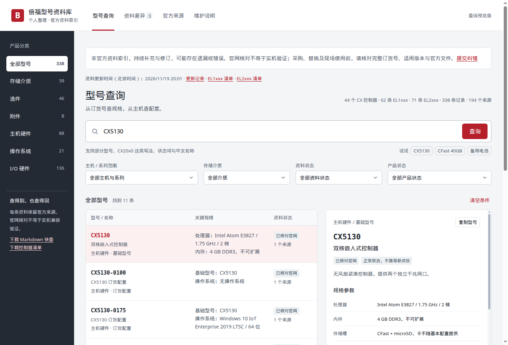

# beckhoff-toolbox

个人维护的 Beckhoff / TwinCAT 资料索引和实用工具。**非官方，非完整目录。** 官网核对不等于实机验证。

## 倍福型号资料库

在线查询：<https://vollmer2012.github.io/beckhoff-toolbox/>

按订货号或中文关键词查看规格简介、官方来源和资料差异。采购、替换和现场使用前，请核对完整订货号、适用版本与官方文件。



<!-- catalog-coverage:start -->
已收录 622 条记录、478 个官方来源：工控机 C 系列 93 条，CX 控制器基础型号 49 个，控制面板与面板式电脑 CP 系列 117 条，存储介质 44 条，操作系统 21 条，EL1xxx 62 条，EL2xxx 71 条。其中 284 条是官网产品页简录，规格未逐项摘录。
尚未覆盖运动控制、伺服、电机、线缆和端子全系列，也不包含 EL3xxx、ED、ES、ELM、EM、ELX、BC/BX。简录只保证能按型号找到官方产品页，不是完整规格，也不等于实机验证。型号规律不能用来判断附件是否兼容。官网核对不等于实机验证。
<!-- catalog-coverage:end -->

可以先试这三条：

- [CX5130](https://vollmer2012.github.io/beckhoff-toolbox/?q=CX5130)
- [CFast 40GB](https://vollmer2012.github.io/beckhoff-toolbox/?q=CFast%2040GB)
- [备用电池](https://vollmer2012.github.io/beckhoff-toolbox/?q=%E5%A4%87%E7%94%A8%E7%94%B5%E6%B1%A0)

没有查到，通常只说明这份资料还没收录，不表示产品不存在或不兼容。型号规律不能用来推断附件是否兼容。需要补充或修正时，请[提交纠错](https://github.com/vollmer2012/beckhoff-toolbox/issues/new?title=%E5%9E%8B%E5%8F%B7%E8%B5%84%E6%96%99%E7%BA%A0%E9%94%99)。

本地构建和字段说明见 [型号资料库](projects/Beckhoff-Model-Library/README.md)。变更说明见 [更新记录](projects/Beckhoff-Model-Library/docs/更新记录.md)，维护者补充条目的步骤见 [维护记录](projects/Beckhoff-Model-Library/docs/维护记录.md)。

## 其他项目

| 项目 | 用途 | 状态 |
| --- | --- | --- |
| [TwinCAT2 CE CerDisp](projects/TwinCAT2-CE-CerDisp/README.md) | TwinCAT 2 程序导出：读取网卡信息并尝试启动 CE 端 CerDisp | 用户反馈已在 CX8090、CX5120-0111 上测试；用于通过plc程序开启ce系统控制器的远程桌面进程 |
| [Beckhoff Finder](projects/Beckhoff-Finder/README.md) | 作者此前发布的 Windows 工具运行版，EXE 通过 Releases 分发 | V1.01 运行版已发布；用于跨网段快速查找beckhoff控制器 |
| [TC3 授权响应文件查看工具](projects/TC3-License-Response-Viewer/README.md) | Windows EXE 运行版，产品元数据名称 TwinCAT_License_UI_Viewer | V1.0 运行版已发布；用于快速查看tc3授权响应文件的概括 |

| [Boot Scanner · Boot 查看器](projects/TwinCAT-Boot-Scanner/README.md) | C# / .NET 8 / WinForms；离线只读查看部分 TwinCAT Boot 配置与符号 | [v1.1.2-preview.1 公开预览](https://github.com/vollmer2012/beckhoff-toolbox/releases/tag/twincat-boot-scanner-v1.1.2-preview.1) · [单 EXE 下载](https://github.com/vollmer2012/beckhoff-toolbox/releases/download/twincat-boot-scanner-v1.1.2-preview.1/BootScanner.exe)；本项目目录采用 MIT，WSM 完整工程尚未解码 |

各项目分别记录依赖、使用步骤、安全事项及兼容性。请先阅读对应项目 README；用户反馈的测试记录与维护者独立复测结果分别标明。

## 目录约定

```text
projects/
  Beckhoff-Model-Library/
  TwinCAT-Boot-Scanner/
    README.md
    LICENSE
    src/
    docs/
  TwinCAT2-CE-CerDisp/
    README.md
    original/
      README.md
      开启CEROMET查看IP.EXP
  Beckhoff-Finder/
    README.md
    SHA256SUMS.txt
  TC3-License-Response-Viewer/
    README.md
    SHA256SUMS.txt
CONTRIBUTING.md
.github/
  ISSUE_TEMPLATE/
  pull_request_template.md
```

后续公开项目放入 `projects/<项目名>/`，并在首页索引登记。项目目录和项目名称不带版本号，具体版本通过各项目的 Release 标签和版本记录管理。原始资料放入项目的 `original/`，改进代码可放入 `src/`，额外文档可放入 `docs/`；按实际内容建立目录。

## 反馈与参与

- [提交问题、建议或兼容性记录](https://github.com/vollmer2012/beckhoff-toolbox/issues/new/choose)。
- [查看和提交 Pull Requests](https://github.com/vollmer2012/beckhoff-toolbox/pulls)。
- 修改流程：Fork → 在自己的分支修改 → 提交 PR → 维护者审核并决定是否合并。详见 [贡献指南](CONTRIBUTING.md)。

普通贡献者通过 PR 提出修改；合并由有相应权限的维护者执行。反馈请注明项目名称、代码版本、设备和软件环境，并去除凭据、客户资料与敏感网络信息。

## 使用与授权说明

本仓库公开展示资料并接受反馈与 PR。目前未添加统一开源许可证；公开访问和提交 PR 不自动授予额外的使用、修改或再分发许可。各文件仍受相应权利人的授权约束。Beckhoff 库文件不随仓库分发。

`projects/TwinCAT-Boot-Scanner/` 下的 Boot Scanner 项目单独采用 MIT 许可，具体以该目录的 LICENSE 和第三方声明为准；这不改变其他项目或原始资料的授权。

涉及 PLC 下载、远程访问或现场设备操作时，应先备份，并在获准的测试环境验证。具体限制和待验证项以各项目说明为准。
