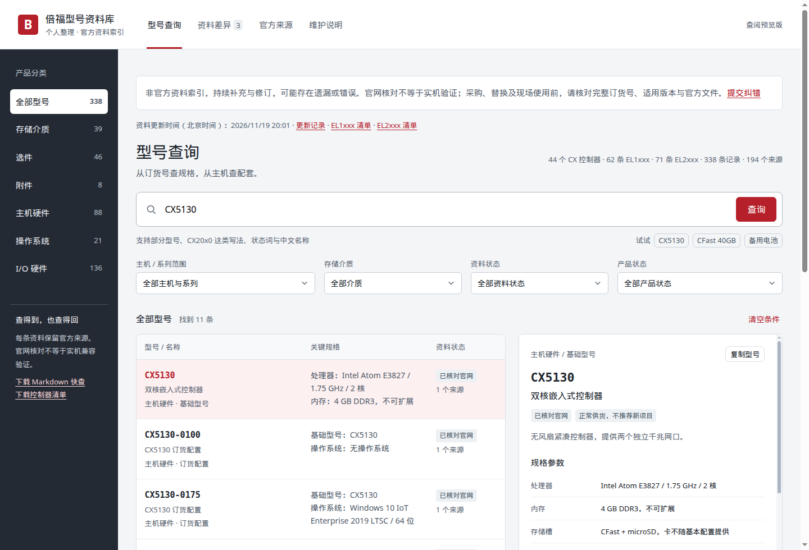

# 倍福型号资料库

**查阅预览版，非倍福官方网站，非完整目录。** 官网核对不等于实机验证。资料持续补充与修订，可能存在遗漏或错误；采购、替换及现场使用前，请核对完整订货号、适用版本和官方文件，必要时向倍福确认。未收录不表示不存在或不兼容。型号规律不能用来推断附件是否兼容。

在线查询：<https://vollmer2012.github.io/beckhoff-toolbox/>



<!-- catalog-coverage:start -->
已收录 738 条记录、594 个官方来源：工控机 C 系列 93 条，CX 控制器基础型号 49 个，控制面板与面板式电脑 CP 系列 117 条，存储介质 44 条，操作系统 21 条，EL1xxx 62 条，EL2xxx 71 条，EL3xxx 117 条。其中 284 条是官网产品页简录，规格未逐项摘录。
尚未覆盖运动控制、伺服、电机、线缆和端子全系列，也不包含 EL4xxx–EL9xxx、ED、ES、ELM、EM、ELX、BC/BX。简录只保证能按型号找到官方产品页，不是完整规格，也不等于实机验证。型号规律不能用来判断附件是否兼容。官网核对不等于实机验证。
<!-- catalog-coverage:end -->

可以先试这三条：[CX5130](https://vollmer2012.github.io/beckhoff-toolbox/?q=CX5130)、[CFast 40GB](https://vollmer2012.github.io/beckhoff-toolbox/?q=CFast%2040GB)、[备用电池](https://vollmer2012.github.io/beckhoff-toolbox/?q=%E5%A4%87%E7%94%A8%E7%94%B5%E6%B1%A0)。

[提交资料纠错](https://github.com/vollmer2012/beckhoff-toolbox/issues/new?title=型号资料纠错)时，请附型号、错误字段、官方来源及版本或截图。修订可在 GitHub 文件历史中追溯。

可维护的官方选型资料索引：型号与中文关键词搜索、分类/主机筛选、规格简介、配套条件、官方来源及资料差异。

[更新记录](docs/更新记录.md) · [维护记录](docs/维护记录.md) · [EL1xxx 清单](docs/EL1xxx收录清单.md) · [EL2xxx 清单](docs/EL2xxx收录清单.md) · [EL3xxx 清单](docs/EL3xxx收录清单.md)。更新时间以记录里的北京时间为准。

**打开查询网页：[dist/index.html](dist/index.html)**。本地浏览器可直接打开该文件；GitHub 页面中点击 HTML 文件只会显示源码，独立网页需要托管。

- [Markdown 型号快查](docs/型号快查.md)
- [控制器收录清单](docs/控制器收录清单.md)
- [EL1xxx 收录清单](docs/EL1xxx收录清单.md)
- [EL2xxx 收录清单](docs/EL2xxx收录清单.md)
- [EL3xxx 收录清单](docs/EL3xxx收录清单.md)
- [维护指南](docs/维护指南.md)
- [唯一维护数据](data/catalog.json)
- [实施方案](docs/实施方案.md)

```powershell
npm test
npm run build
npm start
```

无需安装依赖。Node.js 20+；直接打开已生成的网页则不需要 Node。`npm start` 只启动本机回环预览。`npm run build` 会按目录重写上方收录数字。

公开仓库目录：`vollmer2012/beckhoff-toolbox/projects/Beckhoff-Model-Library/`。网页发布配置与启用步骤见 [网页发布说明](docs/网页发布说明.md)。仓库同步与网页部署分别验收；仅上传文件不代表网站已上线。
